# 읽는 법
자식 → 부모 방향(`→`)은 N:1 이라 행이 늘지 않는 안전한 방향이다. 부모 → 자식(`←`)으로 가서 집계하면 팬 트랩에 주의한다. `⚠` 표시는 직접 조인 금지다.

# 인접 목록
<!-- AUTO:BEGIN adjacency -->
- **[TI_BQMS005_INFA_QT](/schemas/APPADAMSUSER/tables/TI_BQMS005_INFA_QT.md)** (transaction)
  - ← [TI_BQMS005_INFA_QT_2](/schemas/APPADAMSUSER/tables/TI_BQMS005_INFA_QT_2.md) on EPR_CODE, ITEM_ID, REQ_NO, REQ_SEQ, SITE_CODE (1:1, medium, LEFT)
  - ← [TI_BQMS840](/schemas/APPADAMSUSER/tables/TI_BQMS840.md) on SITE_CD, REQ_NO, REQ_SEQ, ITEM_ID, EPR_CD (N:1, medium, LEFT)
- **[TI_BQMS005_INFA_QT_2](/schemas/APPADAMSUSER/tables/TI_BQMS005_INFA_QT_2.md)** (transaction)
  - → [TI_BQMS005_INFA_QT](/schemas/APPADAMSUSER/tables/TI_BQMS005_INFA_QT.md) on EPR_CODE, ITEM_ID, REQ_NO, REQ_SEQ, SITE_CODE (1:1, medium, LEFT)
- **[TI_BQMS008_INFA_PO](/schemas/APPADAMSUSER/tables/TI_BQMS008_INFA_PO.md)** (transaction)
  - ← [TI_BQMS_GR_GR_MST](/schemas/APPADAMSUSER/tables/TI_BQMS_GR_GR_MST.md) on PO_NO, SITE_CODE (N:1, medium, LEFT)
  - ← [TI_BQMS_GR_MST](/schemas/APPADAMSUSER/tables/TI_BQMS_GR_MST.md) on PO_NO, SITE_CODE (N:1, medium, LEFT)
  - ← [TI_BQMS_PO_PO_MST](/schemas/APPADAMSUSER/tables/TI_BQMS_PO_PO_MST.md) on PO_NO, SITE_CODE (1:1, medium, LEFT)
- **[TI_BQMS009_MROMALL_IF](/schemas/APPADAMSUSER/tables/TI_BQMS009_MROMALL_IF.md)** (interface)
  - → [TI_BQMS009_MRO_PR_PO_GR](/schemas/APPADAMSUSER/tables/TI_BQMS009_MRO_PR_PO_GR.md) on GR_NO, ITEM_CODE, IV_NO, IV_SEQ, PO_NO, PO_SEQ, PR_NO, PR_SEQ, SITE_CODE, SP_CODE (1:1, medium, LEFT)
- **[TI_BQMS009_MRO_PR_PO_GR](/schemas/APPADAMSUSER/tables/TI_BQMS009_MRO_PR_PO_GR.md)** (transaction)
  - ← [TI_BQMS009_MROMALL_IF](/schemas/APPADAMSUSER/tables/TI_BQMS009_MROMALL_IF.md) on GR_NO, ITEM_CODE, IV_NO, IV_SEQ, PO_NO, PO_SEQ, PR_NO, PR_SEQ, SITE_CODE, SP_CODE (1:1, medium, LEFT)
- **[TI_BQMS026_INFA_CTRT](/schemas/APPADAMSUSER/tables/TI_BQMS026_INFA_CTRT.md)** (master)
  - ← [TI_BQMS026_INFA_CTRT_H](/schemas/APPADAMSUSER/tables/TI_BQMS026_INFA_CTRT_H.md) on CTR_CATEGORY_ID, CTR_DATE_END, CTR_DATE_START, CTR_NO, EPR_CODE, SITE_CODE (N:1, medium, LEFT)
- **[TI_BQMS026_INFA_CTRT_H](/schemas/APPADAMSUSER/tables/TI_BQMS026_INFA_CTRT_H.md)** (history)
  - → [TI_BQMS026_INFA_CTRT](/schemas/APPADAMSUSER/tables/TI_BQMS026_INFA_CTRT.md) on CTR_CATEGORY_ID, CTR_DATE_END, CTR_DATE_START, CTR_NO, EPR_CODE, SITE_CODE (N:1, medium, LEFT)
- **[TI_BQMS800](/schemas/APPADAMSUSER/tables/TI_BQMS800.md)** (master)
  - ← [TI_BQMS810](/schemas/APPADAMSUSER/tables/TI_BQMS810.md) on ENTP_CD, EPR_CD (N:1, medium, LEFT)
  - ← [TI_BQMS820](/schemas/APPADAMSUSER/tables/TI_BQMS820.md) on ENTP_CD, EPR_CD (N:1, medium, LEFT)
  - ← [TI_BQMS830](/schemas/APPADAMSUSER/tables/TI_BQMS830.md) on ENTP_CD, EPR_CD (N:1, medium, LEFT)
  - ← [TI_BQMS840](/schemas/APPADAMSUSER/tables/TI_BQMS840.md) on ENTP_CD, EPR_CD (N:1, medium, LEFT)
- **[TI_BQMS810](/schemas/APPADAMSUSER/tables/TI_BQMS810.md)** (transaction)
  - → [TI_BQMS800](/schemas/APPADAMSUSER/tables/TI_BQMS800.md) on ENTP_CD, EPR_CD (N:1, medium, LEFT)
- **[TI_BQMS820](/schemas/APPADAMSUSER/tables/TI_BQMS820.md)** (transaction)
  - → [TI_BQMS800](/schemas/APPADAMSUSER/tables/TI_BQMS800.md) on ENTP_CD, EPR_CD (N:1, medium, LEFT)
- **[TI_BQMS830](/schemas/APPADAMSUSER/tables/TI_BQMS830.md)** (transaction)
  - → [TI_BQMS800](/schemas/APPADAMSUSER/tables/TI_BQMS800.md) on ENTP_CD, EPR_CD (N:1, medium, LEFT)
- **[TI_BQMS840](/schemas/APPADAMSUSER/tables/TI_BQMS840.md)** (transaction)
  - → [TI_BQMS005_INFA_QT](/schemas/APPADAMSUSER/tables/TI_BQMS005_INFA_QT.md) on SITE_CD, REQ_NO, REQ_SEQ, ITEM_ID, EPR_CD (N:1, medium, LEFT)
  - → [TI_BQMS800](/schemas/APPADAMSUSER/tables/TI_BQMS800.md) on ENTP_CD, EPR_CD (N:1, medium, LEFT)
- **[TI_BQMS_GR_CLSG](/schemas/APPADAMSUSER/tables/TI_BQMS_GR_CLSG.md)** (master)
  - ← [TI_BQMS_GR_CLSG_ARTICLE](/schemas/APPADAMSUSER/tables/TI_BQMS_GR_CLSG_ARTICLE.md) on CLSG_NO (N:1, medium, LEFT)
- **[TI_BQMS_GR_CLSG_ARTICLE](/schemas/APPADAMSUSER/tables/TI_BQMS_GR_CLSG_ARTICLE.md)** (detail)
  - → [TI_BQMS_GR_CLSG](/schemas/APPADAMSUSER/tables/TI_BQMS_GR_CLSG.md) on CLSG_NO (N:1, medium, LEFT)
- **[TI_BQMS_GR_GR_MST](/schemas/APPADAMSUSER/tables/TI_BQMS_GR_GR_MST.md)** (master)
  - → [TI_BQMS008_INFA_PO](/schemas/APPADAMSUSER/tables/TI_BQMS008_INFA_PO.md) on PO_NO, SITE_CODE (N:1, medium, LEFT)
- **[TI_BQMS_GR_MST](/schemas/APPADAMSUSER/tables/TI_BQMS_GR_MST.md)** (master)
  - → [TI_BQMS008_INFA_PO](/schemas/APPADAMSUSER/tables/TI_BQMS008_INFA_PO.md) on PO_NO, SITE_CODE (N:1, medium, LEFT)
  - → [TI_BQMS_IEN_REQ](/schemas/APPADAMSUSER/tables/TI_BQMS_IEN_REQ.md) on IEN_REQ_NO (N:1, medium, LEFT)
- **[TI_BQMS_IEN_REQ](/schemas/APPADAMSUSER/tables/TI_BQMS_IEN_REQ.md)** (master)
  - ← [TI_BQMS_GR_MST](/schemas/APPADAMSUSER/tables/TI_BQMS_GR_MST.md) on IEN_REQ_NO (N:1, medium, LEFT)
- **[TI_BQMS_MKT_PP_ACTIVITY_MST](/schemas/APPADAMSUSER/tables/TI_BQMS_MKT_PP_ACTIVITY_MST.md)** (master)
  - ← [TI_BQMS_MKT_PP_PR_MAP](/schemas/APPADAMSUSER/tables/TI_BQMS_MKT_PP_PR_MAP.md) on ACT_ITEM_NO, PROPOSAL_ID, PROPOSAL_ITEM_NO (1:1, medium, LEFT)
  - ← [TI_BQMS_PO_PR](/schemas/APPADAMSUSER/tables/TI_BQMS_PO_PR.md) on ACT_ITEM_NO, PROPOSAL_ID, PROPOSAL_ITEM_NO (N:1, medium, LEFT)
- **[TI_BQMS_MKT_PP_PR_MAP](/schemas/APPADAMSUSER/tables/TI_BQMS_MKT_PP_PR_MAP.md)** (mapping)
  - → [TI_BQMS_MKT_PP_ACTIVITY_MST](/schemas/APPADAMSUSER/tables/TI_BQMS_MKT_PP_ACTIVITY_MST.md) on ACT_ITEM_NO, PROPOSAL_ID, PROPOSAL_ITEM_NO (1:1, medium, LEFT)
  - ← [TI_BQMS_PO_PR](/schemas/APPADAMSUSER/tables/TI_BQMS_PO_PR.md) on ACT_ITEM_NO, PROPOSAL_ID, PROPOSAL_ITEM_NO (N:1, medium, LEFT)
- **[TI_BQMS_PO_PO_MST](/schemas/APPADAMSUSER/tables/TI_BQMS_PO_PO_MST.md)** (master)
  - → [TI_BQMS008_INFA_PO](/schemas/APPADAMSUSER/tables/TI_BQMS008_INFA_PO.md) on PO_NO, SITE_CODE (1:1, medium, LEFT)
- **[TI_BQMS_PO_PR](/schemas/APPADAMSUSER/tables/TI_BQMS_PO_PR.md)** (master)
  - → [TI_BQMS_MKT_PP_ACTIVITY_MST](/schemas/APPADAMSUSER/tables/TI_BQMS_MKT_PP_ACTIVITY_MST.md) on ACT_ITEM_NO, PROPOSAL_ID, PROPOSAL_ITEM_NO (N:1, medium, LEFT)
  - → [TI_BQMS_MKT_PP_PR_MAP](/schemas/APPADAMSUSER/tables/TI_BQMS_MKT_PP_PR_MAP.md) on ACT_ITEM_NO, PROPOSAL_ID, PROPOSAL_ITEM_NO (N:1, medium, LEFT)
- **[TI_GRPB004B](/schemas/APPADAMSUSER/tables/TI_GRPB004B.md)** (transaction)
  - → [TI_GRPF911](/schemas/APPADAMSUSER/tables/TI_GRPF911.md) on PLANT (N:1, medium, LEFT)
- **[TI_GRPB004N](/schemas/APPADAMSUSER/tables/TI_GRPB004N.md)** (transaction)
  - → [TI_GRPF911](/schemas/APPADAMSUSER/tables/TI_GRPF911.md) on PLANT (N:1, medium, LEFT)
- **[TI_GRPB013](/schemas/APPADAMSUSER/tables/TI_GRPB013.md)** (transaction)
  - → [TI_GRPF911](/schemas/APPADAMSUSER/tables/TI_GRPF911.md) on PLANT (N:1, medium, LEFT)
- **[TI_GRPB017](/schemas/APPADAMSUSER/tables/TI_GRPB017.md)** (transaction)
  - → [TI_GRPF911](/schemas/APPADAMSUSER/tables/TI_GRPF911.md) on PLANT (N:1, medium, LEFT)
- **[TI_GRPB810](/schemas/APPADAMSUSER/tables/TI_GRPB810.md)** (master)
  - ← [TI_GRPB811](/schemas/APPADAMSUSER/tables/TI_GRPB811.md) on CMCD, ENTP_CD (N:1, medium, LEFT)
  - ← [TI_GRPB812](/schemas/APPADAMSUSER/tables/TI_GRPB812.md) on CMCD, ENTP_CD (N:1, medium, LEFT)
  - ← [TI_GRPB813](/schemas/APPADAMSUSER/tables/TI_GRPB813.md) on CMCD, ENTP_CD (N:1, medium, LEFT)
  - ← [TN_AD_ENTP](/schemas/APPADAMSUSER/tables/TN_AD_ENTP.md) on CMCD, ENTP_CD (N:1, medium, LEFT)
- **[TI_GRPB811](/schemas/APPADAMSUSER/tables/TI_GRPB811.md)** (history)
  - → [TI_GRPB810](/schemas/APPADAMSUSER/tables/TI_GRPB810.md) on CMCD, ENTP_CD (N:1, medium, LEFT)
- **[TI_GRPB812](/schemas/APPADAMSUSER/tables/TI_GRPB812.md)** (summary)
  - → [TI_GRPB810](/schemas/APPADAMSUSER/tables/TI_GRPB810.md) on CMCD, ENTP_CD (N:1, medium, LEFT)
- **[TI_GRPB813](/schemas/APPADAMSUSER/tables/TI_GRPB813.md)** (summary)
  - → [TI_GRPB810](/schemas/APPADAMSUSER/tables/TI_GRPB810.md) on CMCD, ENTP_CD (N:1, medium, LEFT)
- **[TI_GRPB_DE_CONDITION_AMT](/schemas/APPADAMSUSER/tables/TI_GRPB_DE_CONDITION_AMT.md)** (summary)
  - ← [TI_GRPB_DE_PAYMENT](/schemas/APPADAMSUSER/tables/TI_GRPB_DE_PAYMENT.md) on CONDITION_NO (N:1, medium, LEFT)
  - ← [TI_GRPB_DE_PAYMENT_REPORT](/schemas/APPADAMSUSER/tables/TI_GRPB_DE_PAYMENT_REPORT.md) on CONDITION_NO (N:1, medium, LEFT)
  - ← [TI_GRPB_DE_REPORT](/schemas/APPADAMSUSER/tables/TI_GRPB_DE_REPORT.md) on CONDITION_NO (N:1, medium, LEFT)
  - ← [TI_GRPB_DE_SCN](/schemas/APPADAMSUSER/tables/TI_GRPB_DE_SCN.md) on CONDITION_NO (N:1, medium, LEFT)
- **[TI_GRPB_DE_PAYMENT](/schemas/APPADAMSUSER/tables/TI_GRPB_DE_PAYMENT.md)** (transaction)
  - → [TI_GRPB_DE_CONDITION_AMT](/schemas/APPADAMSUSER/tables/TI_GRPB_DE_CONDITION_AMT.md) on CONDITION_NO (N:1, medium, LEFT)
- **[TI_GRPB_DE_PAYMENT_REPORT](/schemas/APPADAMSUSER/tables/TI_GRPB_DE_PAYMENT_REPORT.md)** (transaction)
  - → [TI_GRPB_DE_CONDITION_AMT](/schemas/APPADAMSUSER/tables/TI_GRPB_DE_CONDITION_AMT.md) on CONDITION_NO (N:1, medium, LEFT)
- **[TI_GRPB_DE_REPORT](/schemas/APPADAMSUSER/tables/TI_GRPB_DE_REPORT.md)** (transaction)
  - → [TI_GRPB_DE_CONDITION_AMT](/schemas/APPADAMSUSER/tables/TI_GRPB_DE_CONDITION_AMT.md) on CONDITION_NO (N:1, medium, LEFT)
- **[TI_GRPB_DE_SCN](/schemas/APPADAMSUSER/tables/TI_GRPB_DE_SCN.md)** (mapping)
  - → [TI_GRPB_DE_CONDITION_AMT](/schemas/APPADAMSUSER/tables/TI_GRPB_DE_CONDITION_AMT.md) on CONDITION_NO (N:1, medium, LEFT)
- **[TI_GRPB_INC_REPORT](/schemas/APPADAMSUSER/tables/TI_GRPB_INC_REPORT.md)** (summary)
  - → [TI_GRPF900](/schemas/APPADAMSUSER/tables/TI_GRPF900.md) on CMCD (N:1, medium, LEFT)
- **[TI_GRPB_PRICE_BILLING_REPORT](/schemas/APPADAMSUSER/tables/TI_GRPB_PRICE_BILLING_REPORT.md)** (transaction)
  - → [TI_MT_EXCHRATE](/schemas/APPADAMSUSER/tables/TI_MT_EXCHRATE.md) on BILL_DT, CURRENCY (N:1, medium, LEFT)
- **[TI_GRPB_PRICE_CONDITION](/schemas/APPADAMSUSER/tables/TI_GRPB_PRICE_CONDITION.md)** (detail)
  - → [TI_GRPB_PRICE_HEADER](/schemas/APPADAMSUSER/tables/TI_GRPB_PRICE_HEADER.md) on DOC_NO (N:1, medium, LEFT)
  - → [TI_GRPF911](/schemas/APPADAMSUSER/tables/TI_GRPF911.md) on PLANT (N:1, medium, LEFT)
- **[TI_GRPB_PRICE_HEADER](/schemas/APPADAMSUSER/tables/TI_GRPB_PRICE_HEADER.md)** (master)
  - ← [TI_GRPB_PRICE_CONDITION](/schemas/APPADAMSUSER/tables/TI_GRPB_PRICE_CONDITION.md) on DOC_NO (N:1, medium, LEFT)
  - ← [TI_GRPB_PRICE_ITEM](/schemas/APPADAMSUSER/tables/TI_GRPB_PRICE_ITEM.md) on DOC_NO (N:1, medium, LEFT)
- **[TI_GRPB_PRICE_ITEM](/schemas/APPADAMSUSER/tables/TI_GRPB_PRICE_ITEM.md)** (detail)
  - → [TI_GRPB_PRICE_HEADER](/schemas/APPADAMSUSER/tables/TI_GRPB_PRICE_HEADER.md) on DOC_NO (N:1, medium, LEFT)
  - → [TI_GRPF911](/schemas/APPADAMSUSER/tables/TI_GRPF911.md) on PLANT (N:1, medium, LEFT)
- **[TI_GRPF039](/schemas/APPADAMSUSER/tables/TI_GRPF039.md)** (transaction)
  - → [TI_GRPF861](/schemas/APPADAMSUSER/tables/TI_GRPF861.md) on CMCD, EOITEMNO, EONUM, MBOCD (N:1, medium, LEFT)
  - → [TI_GRPF913](/schemas/APPADAMSUSER/tables/TI_GRPF913.md) on MBOCD (N:1, medium, LEFT)
- **[TI_GRPF039_ACC](/schemas/APPADAMSUSER/tables/TI_GRPF039_ACC.md)** (transaction)
  - → [TI_GRPF861](/schemas/APPADAMSUSER/tables/TI_GRPF861.md) on CMCD, EOITEMNO, EONUM, MBOCD (N:1, medium, LEFT)
  - → [TI_GRPF913](/schemas/APPADAMSUSER/tables/TI_GRPF913.md) on MBOCD (N:1, medium, LEFT)
- **[TI_GRPF060](/schemas/APPADAMSUSER/tables/TI_GRPF060.md)** (master)
  - ⚠ [TI_GRPF061](/schemas/APPADAMSUSER/tables/TI_GRPF061.md) 직접 조인 금지 (N:M)
- **[TI_GRPF061](/schemas/APPADAMSUSER/tables/TI_GRPF061.md)** (detail)
  - ⚠ [TI_GRPF060](/schemas/APPADAMSUSER/tables/TI_GRPF060.md) 직접 조인 금지 (N:M)
- **[TI_GRPF806](/schemas/APPADAMSUSER/tables/TI_GRPF806.md)** (master)
  - ← [TI_GRPF806H](/schemas/APPADAMSUSER/tables/TI_GRPF806H.md) on COCD, IF_GB, INNR_DPCD (N:1, medium, LEFT)
- **[TI_GRPF806H](/schemas/APPADAMSUSER/tables/TI_GRPF806H.md)** (history)
  - → [TI_GRPF806](/schemas/APPADAMSUSER/tables/TI_GRPF806.md) on COCD, IF_GB, INNR_DPCD (N:1, medium, LEFT)
- **[TI_GRPF860](/schemas/APPADAMSUSER/tables/TI_GRPF860.md)** (transaction)
  - → [TI_GRPF861](/schemas/APPADAMSUSER/tables/TI_GRPF861.md) on CMCD, EOITEMNO, EONUM, MBOCD (N:1, medium)
  - → [TI_GRPF913](/schemas/APPADAMSUSER/tables/TI_GRPF913.md) on MBOCD (N:1, medium, LEFT)
- **[TI_GRPF861](/schemas/APPADAMSUSER/tables/TI_GRPF861.md)** (summary)
  - ← [TI_GRPF039](/schemas/APPADAMSUSER/tables/TI_GRPF039.md) on CMCD, EOITEMNO, EONUM, MBOCD (N:1, medium, LEFT)
  - ← [TI_GRPF039_ACC](/schemas/APPADAMSUSER/tables/TI_GRPF039_ACC.md) on CMCD, EOITEMNO, EONUM, MBOCD (N:1, medium, LEFT)
  - ← [TI_GRPF860](/schemas/APPADAMSUSER/tables/TI_GRPF860.md) on CMCD, EOITEMNO, EONUM, MBOCD (N:1, medium)
  - ← [TI_GRPF_EO_ACC](/schemas/APPADAMSUSER/tables/TI_GRPF_EO_ACC.md) on CMCD, EOITEMNO, EONUM, MBOCD (N:1, medium, LEFT)
  - → [TI_GRPF913](/schemas/APPADAMSUSER/tables/TI_GRPF913.md) on MBOCD (N:1, medium, LEFT)
- **[TI_GRPF900](/schemas/APPADAMSUSER/tables/TI_GRPF900.md)** (master)
  - ← [TI_GRPB_INC_REPORT](/schemas/APPADAMSUSER/tables/TI_GRPB_INC_REPORT.md) on CMCD (N:1, medium, LEFT)
- **[TI_GRPF902](/schemas/APPADAMSUSER/tables/TI_GRPF902.md)** (master)
  - ← [TI_GRPF902_ALL](/schemas/APPADAMSUSER/tables/TI_GRPF902_ALL.md) on SAKNR (N:1, medium, LEFT)
- **[TI_GRPF902_ALL](/schemas/APPADAMSUSER/tables/TI_GRPF902_ALL.md)** (master)
  - → [TI_GRPF902](/schemas/APPADAMSUSER/tables/TI_GRPF902.md) on SAKNR (N:1, medium, LEFT)
- **[TI_GRPF910](/schemas/APPADAMSUSER/tables/TI_GRPF910.md)** (code)
  - → [TI_GRPF910_GRP](/schemas/APPADAMSUSER/tables/TI_GRPF910_GRP.md) on GRPCD (N:1, medium, LEFT)
- **[TI_GRPF910_GRP](/schemas/APPADAMSUSER/tables/TI_GRPF910_GRP.md)** (code)
  - ← [TI_GRPF910](/schemas/APPADAMSUSER/tables/TI_GRPF910.md) on GRPCD (N:1, medium, LEFT)
- **[TI_GRPF911](/schemas/APPADAMSUSER/tables/TI_GRPF911.md)** (master)
  - ← [TI_GRPB004B](/schemas/APPADAMSUSER/tables/TI_GRPB004B.md) on PLANT (N:1, medium, LEFT)
  - ← [TI_GRPB004N](/schemas/APPADAMSUSER/tables/TI_GRPB004N.md) on PLANT (N:1, medium, LEFT)
  - ← [TI_GRPB013](/schemas/APPADAMSUSER/tables/TI_GRPB013.md) on PLANT (N:1, medium, LEFT)
  - ← [TI_GRPB017](/schemas/APPADAMSUSER/tables/TI_GRPB017.md) on PLANT (N:1, medium, LEFT)
  - ← [TI_GRPB_PRICE_CONDITION](/schemas/APPADAMSUSER/tables/TI_GRPB_PRICE_CONDITION.md) on PLANT (N:1, medium, LEFT)
  - ← [TI_GRPB_PRICE_ITEM](/schemas/APPADAMSUSER/tables/TI_GRPB_PRICE_ITEM.md) on PLANT (N:1, medium, LEFT)
  - ← [TI_GSCM003](/schemas/APPADAMSUSER/tables/TI_GSCM003.md) on PLANT (N:1, medium, LEFT)
- **[TI_GRPF913](/schemas/APPADAMSUSER/tables/TI_GRPF913.md)** (master)
  - ← [TI_GRPF039](/schemas/APPADAMSUSER/tables/TI_GRPF039.md) on MBOCD (N:1, medium, LEFT)
  - ← [TI_GRPF039_ACC](/schemas/APPADAMSUSER/tables/TI_GRPF039_ACC.md) on MBOCD (N:1, medium, LEFT)
  - ← [TI_GRPF860](/schemas/APPADAMSUSER/tables/TI_GRPF860.md) on MBOCD (N:1, medium, LEFT)
  - ← [TI_GRPF861](/schemas/APPADAMSUSER/tables/TI_GRPF861.md) on MBOCD (N:1, medium, LEFT)
  - ← [TI_GRPF_EO_ACC](/schemas/APPADAMSUSER/tables/TI_GRPF_EO_ACC.md) on MBOCD (N:1, medium, LEFT)
  - ← [TI_GRPF_EO_REPORT](/schemas/APPADAMSUSER/tables/TI_GRPF_EO_REPORT.md) on MBOCD (N:1, medium, LEFT)
  - ← [TI_GRPF_EO_INFO](/schemas/APPADAMSUSER/tables/TI_GRPF_EO_INFO.md) on MBO_CODE (N:1, medium, LEFT)
  - ← [TI_GRPF_EO_INFO_REPORT](/schemas/APPADAMSUSER/tables/TI_GRPF_EO_INFO_REPORT.md) on MBO_CODE (N:1, medium, LEFT)
- **[TI_GRPF_EO_ACC](/schemas/APPADAMSUSER/tables/TI_GRPF_EO_ACC.md)** (transaction)
  - → [TI_GRPF861](/schemas/APPADAMSUSER/tables/TI_GRPF861.md) on CMCD, EOITEMNO, EONUM, MBOCD (N:1, medium, LEFT)
  - → [TI_GRPF913](/schemas/APPADAMSUSER/tables/TI_GRPF913.md) on MBOCD (N:1, medium, LEFT)
- **[TI_GRPF_EO_INFO](/schemas/APPADAMSUSER/tables/TI_GRPF_EO_INFO.md)** (transaction)
  - → [TI_GRPF913](/schemas/APPADAMSUSER/tables/TI_GRPF913.md) on MBO_CODE (N:1, medium, LEFT)
- **[TI_GRPF_EO_INFO_REPORT](/schemas/APPADAMSUSER/tables/TI_GRPF_EO_INFO_REPORT.md)** (transaction)
  - → [TI_GRPF913](/schemas/APPADAMSUSER/tables/TI_GRPF913.md) on MBO_CODE (N:1, medium, LEFT)
- **[TI_GRPF_EO_REPORT](/schemas/APPADAMSUSER/tables/TI_GRPF_EO_REPORT.md)** (transaction)
  - → [TI_GRPF913](/schemas/APPADAMSUSER/tables/TI_GRPF913.md) on MBOCD (N:1, medium, LEFT)
- **[TI_GSCM003](/schemas/APPADAMSUSER/tables/TI_GSCM003.md)** (transaction)
  - → [TI_GRPF911](/schemas/APPADAMSUSER/tables/TI_GRPF911.md) on PLANT (N:1, medium, LEFT)
- **[TI_MT_EXCHRATE](/schemas/APPADAMSUSER/tables/TI_MT_EXCHRATE.md)** (master)
  - ← [TI_GRPB_PRICE_BILLING_REPORT](/schemas/APPADAMSUSER/tables/TI_GRPB_PRICE_BILLING_REPORT.md) on BILL_DT, CURRENCY (N:1, medium, LEFT)
  - ⚠ [TI_MT_EXCHRATE_YM](/schemas/APPADAMSUSER/tables/TI_MT_EXCHRATE_YM.md) 직접 조인 금지 (N:M)
  - ⚠ [TI_MT_EXCHRATE_YW](/schemas/APPADAMSUSER/tables/TI_MT_EXCHRATE_YW.md) 직접 조인 금지 (N:M)
- **[TI_MT_EXCHRATE_YM](/schemas/APPADAMSUSER/tables/TI_MT_EXCHRATE_YM.md)** (summary)
  - ⚠ [TI_MT_EXCHRATE](/schemas/APPADAMSUSER/tables/TI_MT_EXCHRATE.md) 직접 조인 금지 (N:M)
- **[TI_MT_EXCHRATE_YW](/schemas/APPADAMSUSER/tables/TI_MT_EXCHRATE_YW.md)** (summary)
  - ⚠ [TI_MT_EXCHRATE](/schemas/APPADAMSUSER/tables/TI_MT_EXCHRATE.md) 직접 조인 금지 (N:M)
- **[TN_AD_ENTP](/schemas/APPADAMSUSER/tables/TN_AD_ENTP.md)** (master)
  - → [TI_GRPB810](/schemas/APPADAMSUSER/tables/TI_GRPB810.md) on CMCD, ENTP_CD (N:1, medium, LEFT)
- **[TN_AD_MASTER_BASE](/schemas/SETADAMSUSER/tables/TN_AD_MASTER_BASE.md)** (master)
  - ← [TN_AD_MASTER_COLUMN](/schemas/SETADAMSUSER/tables/TN_AD_MASTER_COLUMN.md) on MASTER_ID, MASTER_VER (N:1, medium, LEFT)
- **[TN_AD_MASTER_COLUMN](/schemas/SETADAMSUSER/tables/TN_AD_MASTER_COLUMN.md)** (master)
  - → [TN_AD_MASTER_BASE](/schemas/SETADAMSUSER/tables/TN_AD_MASTER_BASE.md) on MASTER_ID, MASTER_VER (N:1, medium, LEFT)
- **[TN_AD_SCENARIO_BASE](/schemas/SETADAMSUSER/tables/TN_AD_SCENARIO_BASE.md)** (master)
  - ← [TN_AD_SCENARIO_LOGIC](/schemas/SETADAMSUSER/tables/TN_AD_SCENARIO_LOGIC.md) on SCENARIO_ID, SCENARIO_VER (N:1, high, LEFT)
- **[TN_AD_SCENARIO_COLUMN](/schemas/SETADAMSUSER/tables/TN_AD_SCENARIO_COLUMN.md)** (master)
  - → [TN_AD_SCENARIO_LOGIC](/schemas/SETADAMSUSER/tables/TN_AD_SCENARIO_LOGIC.md) on SCENARIO_ID, SCENARIO_STEP, SCENARIO_VER (N:1, medium, LEFT)
- **[TN_AD_SCENARIO_LOGIC](/schemas/SETADAMSUSER/tables/TN_AD_SCENARIO_LOGIC.md)** (master)
  - → [TN_AD_SCENARIO_BASE](/schemas/SETADAMSUSER/tables/TN_AD_SCENARIO_BASE.md) on SCENARIO_ID, SCENARIO_VER (N:1, high, LEFT)
  - ← [TN_AD_SCENARIO_COLUMN](/schemas/SETADAMSUSER/tables/TN_AD_SCENARIO_COLUMN.md) on SCENARIO_ID, SCENARIO_STEP, SCENARIO_VER (N:1, medium, LEFT)
  - ← [TS_AD_SCN_KCNT](/schemas/SETADAMSUSER/tables/TS_AD_SCN_KCNT.md) on SCENARIO_ID, SCENARIO_STEP, SCENARIO_VER (N:1, medium, LEFT)
  - ← [TS_AD_SCN_RST](/schemas/SETADAMSUSER/tables/TS_AD_SCN_RST.md) on SCENARIO_ID, SCENARIO_STEP, SCENARIO_VER (N:1, medium, LEFT)
- **[TS_AD_SCN_KCNT](/schemas/SETADAMSUSER/tables/TS_AD_SCN_KCNT.md)** (summary)
  - → [TN_AD_SCENARIO_LOGIC](/schemas/SETADAMSUSER/tables/TN_AD_SCENARIO_LOGIC.md) on SCENARIO_ID, SCENARIO_STEP, SCENARIO_VER (N:1, medium, LEFT)
- **[TS_AD_SCN_RST](/schemas/SETADAMSUSER/tables/TS_AD_SCN_RST.md)** (summary)
  - → [TN_AD_SCENARIO_LOGIC](/schemas/SETADAMSUSER/tables/TN_AD_SCENARIO_LOGIC.md) on SCENARIO_ID, SCENARIO_STEP, SCENARIO_VER (N:1, medium, LEFT)
<!-- AUTO:END adjacency -->

# 다이어그램
<!-- AUTO:BEGIN diagrams -->
## 연결 요소 1 (테이블 9개)
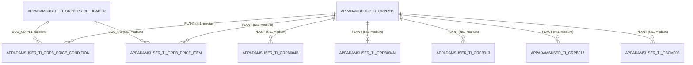

## 연결 요소 2 (테이블 9개)
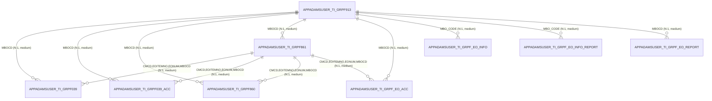

## 연결 요소 3 (테이블 7개)
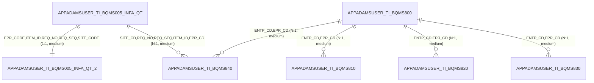

## 연결 요소 4 (테이블 5개)
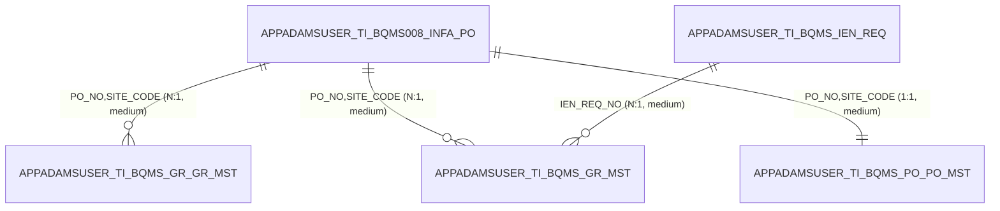

## 연결 요소 5 (테이블 5개)
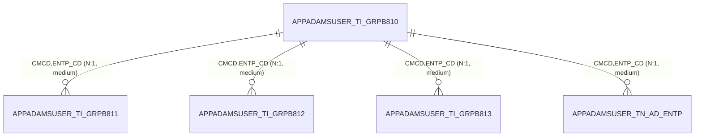

## 연결 요소 6 (테이블 5개)
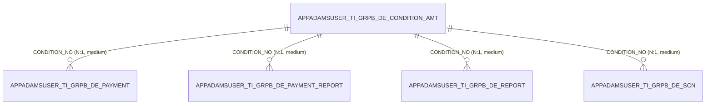

## 연결 요소 7 (테이블 5개)
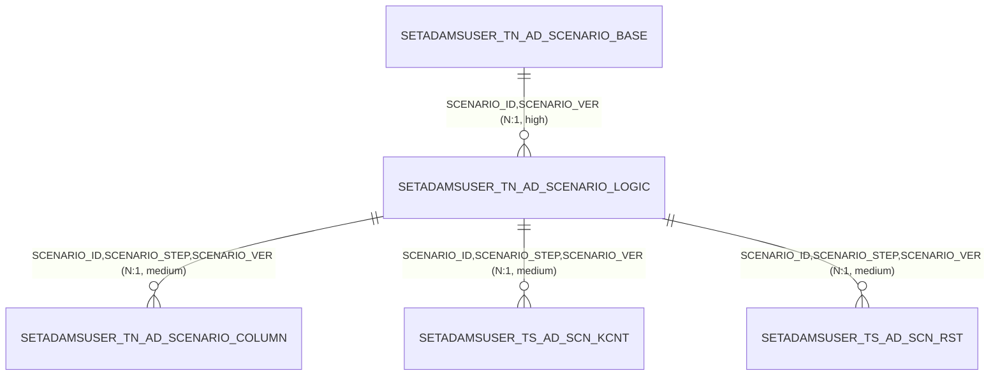

## 연결 요소 8 (테이블 3개)
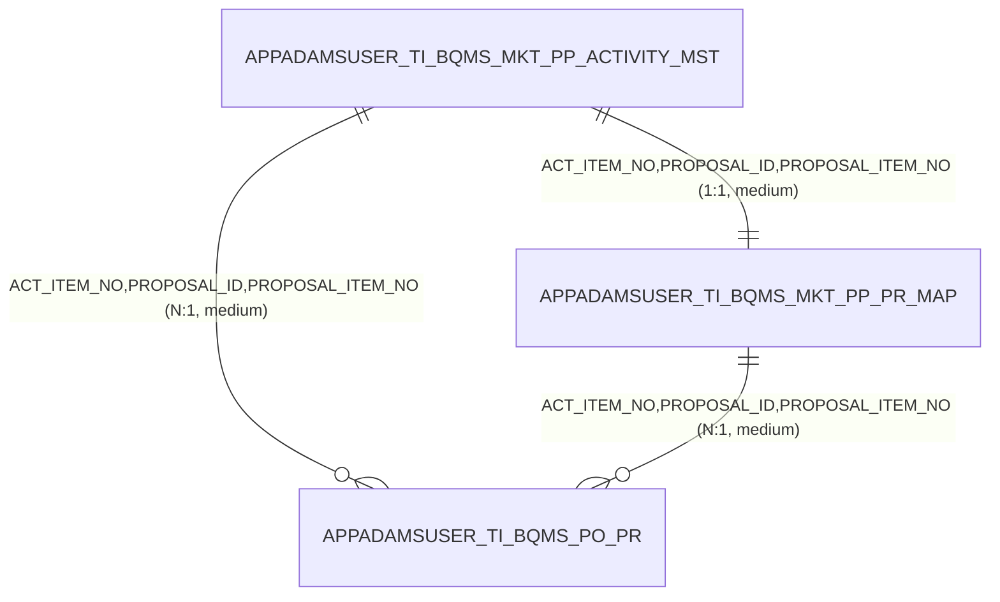

## 연결 요소 9 (테이블 2개)
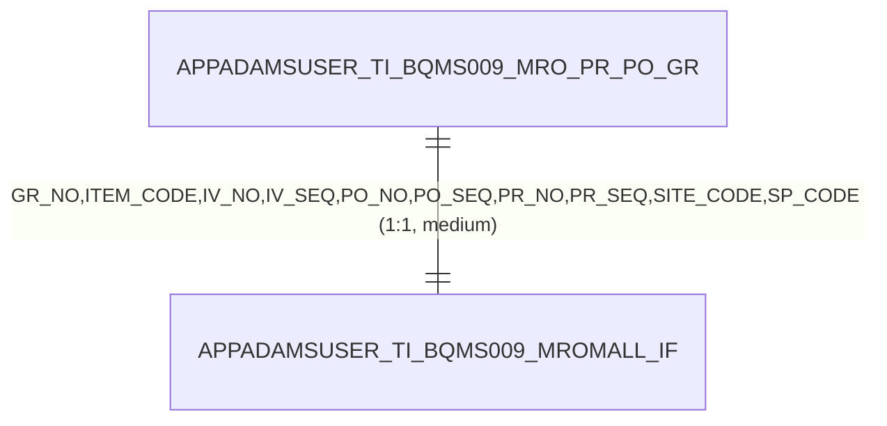

## 연결 요소 10 (테이블 2개)
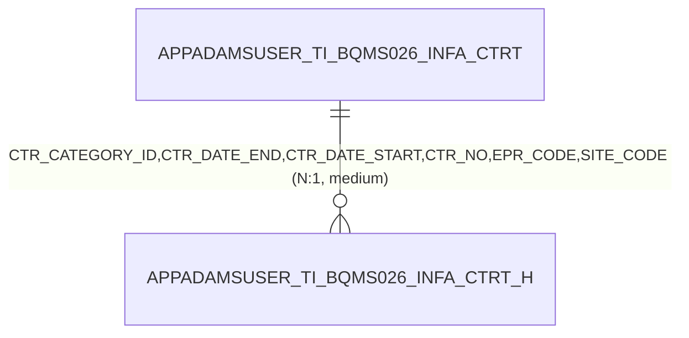

## 연결 요소 11 (테이블 2개)
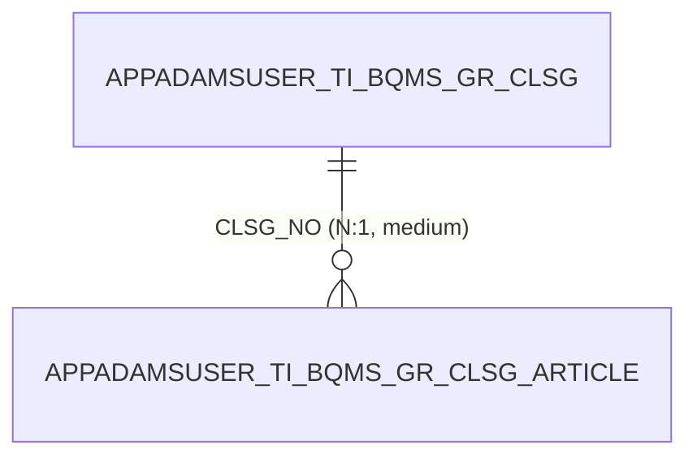

## 연결 요소 12 (테이블 2개)
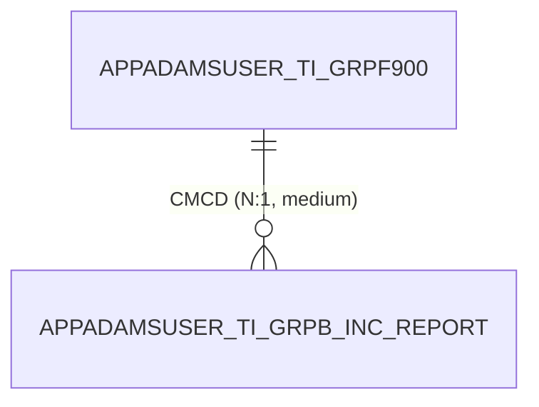

(연결 요소 17개 중 큰 12개만 그렸다)
<!-- AUTO:END diagrams -->
